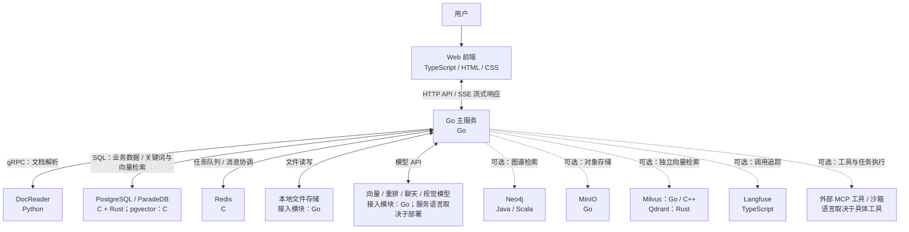

# WeKnora 组件说明

本文根据本地源码、启动脚本和配置整理，说明主要组件的职责、实现语言及相互关系。

- 源码目录：`/Users/barryshen/source_code/WeKnora`
- 整理日期：2026-10-12
- 部署背景：当前使用本地开发模式，基础设施通过 Docker 运行，前端、Go 后端和 DocReader 在本机启动。

## 1. 核心组件与实现语言

WeKnora 自身主要使用 **TypeScript、Go 和 Python**。数据库、缓存和其他第三方服务具有各自的实现语言；后端通过协议或客户端库连接它们。

| 组件 | 主要实现语言 | 职责 | 源码位置或实现来源 | 部署形态 |
| --- | --- | --- | --- | --- |
| Web 前端 | TypeScript、HTML、CSS/Less | 文档上传、知识库管理、聊天、模型与智能体配置 | `frontend/`，Vue 3 + Vite | 开发时为本机进程；标准容器部署由 NGINX 托管静态文件 |
| Go 主服务 | Go | 提供 API，处理用户权限、业务逻辑、组件调用和流式回答 | `cmd/server/`、`internal/`，Gin 框架 | 本机进程或 `app` 容器 |
| DocReader | Python | 解析 PDF、Word、Excel、网页等，提取文本、图片并渲染页面 | `docreader/`，Python gRPC 服务 | 独立本机进程或 `docreader` 容器 |
| PostgreSQL / ParadeDB | PostgreSQL 核心为 C；ParadeDB 搜索扩展为 Rust | 保存业务数据、文档分块和聊天记录，提供 BM25 关键词检索 | 第三方 PostgreSQL / ParadeDB | 独立数据库容器 |
| pgvector | C | 保存和检索文本向量 | 第三方 PostgreSQL 扩展 | 运行在 PostgreSQL 内部，不是独立容器 |
| Redis | C | 异步任务队列、流式消息协调、设置变更通知、限流和模型并发控制 | 第三方 Redis | 独立缓存与队列容器 |
| 文件存储模块 | Go | 保存和读取原文件、解析图片及其他文件产物 | `internal/application/service/`、`internal/application/repository/` 中的存储实现 | 后端内部模块；默认使用本地目录 |
| AI 模型接入模块 | Go | 接入向量模型、重排模型、聊天模型及视觉/OCR 服务 | `internal/models/`、`internal/reranking/` | 后端内部模块，调用本地或远程模型服务 |

AI 模型接入模块使用 Go；模型服务本身的语言取决于具体供应商或推理框架，不能统一标为 Go 或 Python。

### 后端内部模块

以下组件属于 Go 主服务内部，并不各自对应一个容器。

| 模块 | 语言 | 职责 | 主要源码位置 |
| --- | --- | --- | --- |
| API 路由与请求处理 | Go | 接收前端及其他客户端请求 | `internal/router/`、`internal/handler/` |
| 认证与访问控制 | Go | 用户认证、空间权限、知识库访问控制 | `internal/middleware/`、`internal/application/access/` |
| 知识管理与文档处理 | Go | 文档导入、分块、索引、状态更新及知识库管理 | `internal/application/service/`、`internal/infrastructure/chunker/` |
| RAG 问答流水线 | Go | 理解问题、检索、重排、合并上下文、生成回答 | `internal/application/service/chat_pipeline/` |
| 智能体引擎 | Go | 多步决策、知识检索、工具调用和任务执行 | `internal/agent/` |
| 异步任务处理器 | Go | 从 Redis 队列领取并执行文档处理、摘要、Wiki 等任务 | `internal/application/service/` 等，通过 Asynq 调度 |
| 数据访问与检索适配 | Go | 访问数据库和不同检索引擎 | `internal/application/repository/` |
| MCP 集成 | Go | 调用外部 MCP 工具，并向外部客户端提供知识检索等能力 | `internal/mcp/`、`internal/mcpserver/` |
| 流式消息管理 | Go | 将回答、进度和引用事件持续推送给客户端 | `internal/stream/` |
| 沙箱接入 | Go | 连接 Docker 或远程沙箱，执行智能体工具与技能 | `internal/sandbox/`、`internal/localsandbox/` |

## 2. 组件关系

Go 后端是协调中心：前端通过它访问知识和模型，文档解析、数据库、Redis 及文件存储分别提供专业能力。

实线表示本地基础架构中的主要通信关系，虚线表示按配置接入的可选能力。关系图不代表所有组件当前都已启动。

| 通信双方 | 协议或方式 | 交换内容 |
| --- | --- | --- |
| 前端 ↔ Go 后端 | HTTP API、SSE | 业务请求、回答、引用和进度事件 |
| Go 后端 → DocReader | gRPC | 文件或 URL，以及解析结果 |
| Go 后端 ↔ PostgreSQL | PostgreSQL 协议 | 用户、知识库、文档分块、会话及检索数据 |
| Go 后端 ↔ Redis | Redis 协议 | 队列任务、消息、通知和控制状态 |
| Go 后端 ↔ 本地文件目录 | 文件系统读写 | 原文件、图片及文件产物 |
| Go 后端 ↔ 模型服务 | 模型 API，通常为 HTTP/HTTPS | 文本向量、排序分数、模型回答及图像识别结果 |
| Go 后端 → Neo4j | Bolt | 图谱实体、关系及图谱检索结果 |

## 3. 典型处理流程

### 3.1 上传文档并建立知识索引

1. 用户通过前端上传文件，Go 后端检查权限并保存文件及文档记录。
2. 后端将文档处理任务放入 Redis 队列。
3. Go 后端进程中的任务处理器领取任务，调用 DocReader 解析文档。
4. DocReader 返回文本、图片或页面渲染结果；需要 OCR/视觉识别时，由 Go 后端调用相应模型服务。
5. 后端将文本切成可检索的小段，调用 Embedding 向量模型生成向量。
6. 后端将文档分块、向量和关键词索引写入配置的数据库或检索引擎。
7. 按知识库配置执行摘要、问题生成或图谱抽取等后续任务，并更新处理状态。

**Redis 负责排队和协调，执行任务的是 Go 后端中的处理器。**

### 3.2 基于知识库回答问题

1. 前端把问题发送给 Go 后端。
2. 后端结合会话历史理解问题，并按配置改写查询。
3. 后端调用向量模型生成查询向量，在检索引擎中进行关键词与向量混合检索；配置了图谱或联网搜索时，可增加相应检索结果。
4. 后端按配置重排、去重和合并文档片段，组装问题、历史与参考资料。
5. 聊天模型根据这些上下文生成回答。
6. 后端通过 SSE 向前端逐步返回回答及引用。

这条链路称为 RAG：先检索资料，再基于资料生成回答。默认配置使用 PostgreSQL 承担业务存储与检索，因此无需额外部署独立向量数据库。

### 3.3 智能体执行任务

智能体引擎使用 Go 编写，运行在主后端中。它可根据任务反复调用知识检索、联网搜索、外部 MCP 工具或沙箱，再将结果交给模型继续决策。外部工具与沙箱内执行的程序可以使用其他语言。

## 4. 可选组件与其他入口

| 组件 | 主要语言 | 用途 | 与主系统的关系 |
| --- | --- | --- | --- |
| Neo4j | Java、Scala | 知识图谱与 GraphRAG | 后端写入实体和关系，并在问答时查询 |
| MinIO | Go | 对象存储 | 可替代本地目录存储文档与图片 |
| Milvus | Go、C++ | 独立向量数据库 | 后端通过检索适配器访问 |
| Qdrant | Rust | 独立向量数据库 | 后端通过检索适配器访问 |
| Langfuse | TypeScript | 模型调用追踪与评估 | 后端上报模型调用和流水线追踪；完整部署还包含数据库等依赖 |
| CLI | Go | 命令行管理知识库、文档、会话等 | `cli/`，通过 HTTP API 访问主后端 |
| Go SDK | Go | 为其他 Go 项目提供集成接口 | `client/`，封装主后端 API |
| 桌面端 | Go + TypeScript | 桌面应用 | `cmd/desktop/` 与前端，使用 Wails |
| 旧版独立 MCP Server | Python | 兼容旧 MCP 集成部署 | `mcp-server/`，已弃用；新部署使用 Go 后端内置 MCP Server |

仓库还支持其他检索引擎、对象存储和渠道接入，具体以配置和架构文档为准。Docker Compose 文件是 YAML 配置，负责定义服务和连接方式；容器不是一种编程语言。

## 5. 本地开发配置

以下为整理时的配置与检查结果；端口和运行状态可能随启动、停止及配置调整而变化。

| 组件 | 配置地址或端口 | 部署方式 | 检查结果（2026-10-12） |
| --- | --- | --- | --- |
| Web 前端 | `localhost:5174` | 本机进程 | 当次检查未发现该端口的监听进程 |
| Go 后端 | `localhost:8080` | 本机进程 | 当次检查未发现该端口的监听进程 |
| DocReader | `localhost:50051` | 本机 Python 进程 | 当次检查发现监听进程 |
| PostgreSQL / ParadeDB | `localhost:5434` → 容器 `5432` | `WeKnora-postgres-dev` 容器 | 运行中，健康检查通过 |
| Redis | `localhost:6381` → 容器 `6379` | `WeKnora-redis-dev` 容器 | 运行中 |
| 本地文件存储 | `.local-data/files` | 本地目录 | `STORAGE_TYPE=local`；开发脚本默认使用此目录 |

其他配置说明：

- 默认业务数据库和检索引擎均使用 PostgreSQL。
- DocReader 设置为本机运行模式，因此不在当前项目的容器列表中。
- Langfuse 在本地配置中关闭。
- `.env.local` 中启用了 `NEO4J_ENABLE=true`，但当次检查未发现项目所属的 Neo4j 容器，其服务可用性尚未确认。启用配置开关不等于服务已经运行。
- 本地开发启动方式见 `develop.md`；标准容器部署方式见 `docker-compose.yml`。

## 6. 参考资料

- [项目总体架构](website-docs/02-architecture/01-overview.md)
- [RAG 问答流水线](website-docs/02-architecture/04-rag-pipeline.md)
- [本地开发指南](develop.md)
- [开发环境容器配置](docker-compose.dev.yml)
- [标准容器配置](docker-compose.yml)
- [前端依赖](frontend/package.json)
- [Go 后端依赖](go.mod)
- [DocReader 依赖](docreader/pyproject.toml)
- 第三方实现：[PostgreSQL](https://github.com/postgres/postgres)、[ParadeDB](https://github.com/paradedb/paradedb)、[pgvector](https://github.com/pgvector/pgvector)、[Redis](https://github.com/redis/redis)
- 可选组件实现：[Neo4j](https://github.com/neo4j/neo4j)、[MinIO](https://github.com/minio/minio)、[Milvus](https://github.com/milvus-io/milvus)、[Qdrant](https://github.com/qdrant/qdrant)、[Langfuse](https://github.com/langfuse/langfuse)
