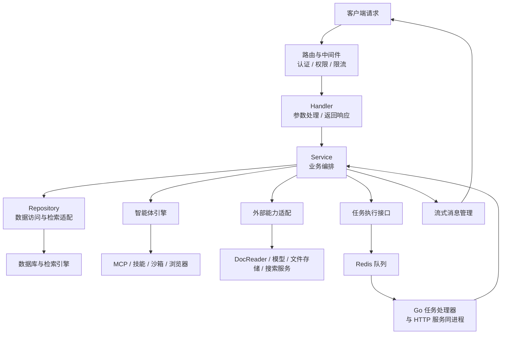

# WeKnora Go 主后端模块说明

本文根据本地源码整理，说明 Go 主后端的功能模块、代码分层、模块关系和典型调用流程。

- 整理日期：2026-10-12
- 主服务入口：[`cmd/server/main.go`](cmd/server/main.go)
- 后端源码：[`internal/`](internal/)
- 主要实现语言：**Go**
- 核心技术：Gin（HTTP）、GORM（数据访问）、uber/dig（依赖装配）、Asynq（异步任务）、gRPC（文档解析服务通信）。

## 1. 运行边界

主后端是协调中心，接收客户端请求，并连接数据库、Redis、DocReader、模型服务和可选工具。

本文中的“模块”表示主后端内部的功能划分，不等同于独立服务或容器。标准部署中，HTTP 服务和 Asynq 任务处理器运行在同一个 Go 进程内；Redis 队列、PostgreSQL、Python DocReader 和模型服务在该进程之外。

## 2. 功能模块

下表按业务职责归纳模块。多个模块的实现可能共同位于 `internal/application/service/`，并非每个模块都有单独目录。

| 模块 | 主要职责 | 代表源码 |
| --- | --- | --- |
| 用户、空间与权限 | 登录认证、API Key、空间成员、角色权限、组织共享、邀请及审计 | [`service/user.go`](internal/application/service/user.go)、[`service/tenant.go`](internal/application/service/tenant.go)、[`access/`](internal/application/access/)、[`middleware/`](internal/middleware/) |
| 知识库与文档管理 | 知识库、文档、文件夹、FAQ、标签、共享、复制和移动 | [`service/knowledgebase.go`](internal/application/service/knowledgebase.go)、[`service/knowledge.go`](internal/application/service/knowledge.go)、[`service/knowledge_faq.go`](internal/application/service/knowledge_faq.go) |
| 文档处理与索引 | 调用解析服务，完成分块、图片处理、向量化、索引及后续富化 | [`service/knowledge_process.go`](internal/application/service/knowledge_process.go)、[`service/knowledge_post_process.go`](internal/application/service/knowledge_post_process.go)、[`infrastructure/docparser/`](internal/infrastructure/docparser/)、[`infrastructure/chunker/`](internal/infrastructure/chunker/) |
| 检索引擎与图谱 | 关键词与向量混合检索、多库检索、结果融合、知识图谱访问及不同引擎适配 | [`service/knowledgebase_search.go`](internal/application/service/knowledgebase_search.go)、[`service/retriever/`](internal/application/service/retriever/)、[`repository/retriever/`](internal/application/repository/retriever/)、[`service/graph.go`](internal/application/service/graph.go) |
| RAG 问答流水线 | 理解问题、召回资料、重排、合并上下文、构造模型输入、流式生成回答 | [`service/session_knowledge_qa.go`](internal/application/service/session_knowledge_qa.go)、[`service/chat_pipeline/`](internal/application/service/chat_pipeline/) |
| 会话、消息与产物 | 聊天历史、附件、会话分叉与回退、消息、文件产物和引用管理 | [`service/session.go`](internal/application/service/session.go)、[`service/message.go`](internal/application/service/message.go)、[`service/artifact_collector.go`](internal/application/service/artifact_collector.go) |
| 智能体引擎 | 多步推理、工具选择和调用、观察执行结果、上下文管理及工具审批 | [`agent/`](internal/agent/)、[`service/agent_service.go`](internal/application/service/agent_service.go)、[`service/session_agent_qa.go`](internal/application/service/session_agent_qa.go) |
| 模型管理与接入 | 管理模型配置和目录，接入聊天、Embedding、Rerank、视觉等模型，控制调用并发 | [`service/model.go`](internal/application/service/model.go)、[`models/`](internal/models/)、[`reranking/`](internal/reranking/) |
| 异步任务系统 | 调度解析、摘要、图谱、问题生成、数据同步、Wiki 生成和清理任务，提供巡检及取消能力 | [`router/task.go`](internal/router/task.go)、[`router/task_inspector.go`](internal/router/task_inspector.go)、[`types/task.go`](internal/types/task.go) |
| 数据源同步 | 连接外部数据源，按计划同步内容到知识库 | [`datasource/`](internal/datasource/)、[`service/datasource_service.go`](internal/application/service/datasource_service.go) |
| Wiki | 根据知识生成和维护 Wiki 页面、引用、交叉链接及索引 | [`service/wiki_ingest.go`](internal/application/service/wiki_ingest.go)、[`service/wiki_page.go`](internal/application/service/wiki_page.go) |
| 长期记忆 | 提取、管理和召回个人记忆，辅助后续问答 | [`service/memory/`](internal/application/service/memory/)、[`repository/memory.go`](internal/application/repository/memory.go) |
| 联网搜索与网页读取 | 管理搜索提供方，检索网页并提取页面内容 | [`service/web_search.go`](internal/application/service/web_search.go)、[`infrastructure/web_search/`](internal/infrastructure/web_search/)、[`infrastructure/web_fetch/`](internal/infrastructure/web_fetch/) |
| MCP 集成 | 调用外部 MCP 工具；通过内置 MCP Server 向外部客户端提供能力 | [`mcp/`](internal/mcp/)、[`mcpserver/`](internal/mcpserver/)、[`service/mcp_service.go`](internal/application/service/mcp_service.go) |
| 技能、沙箱与浏览器 | 技能安装和执行、会话执行环境、终端与桌面操作、本机浏览器能力 | [`agent/skills/`](internal/agent/skills/)、[`sandbox/`](internal/sandbox/)、[`localsandbox/`](internal/localsandbox/)、[`browserskill/`](internal/browserskill/) |
| 渠道接入与发布 | 微信、飞书、Slack 等 IM 渠道接入及网页嵌入渠道管理 | [`im/`](internal/im/)、[`service/embed_channel.go`](internal/application/service/embed_channel.go)、[`service/embed_session.go`](internal/application/service/embed_session.go) |
| 文件与存储管理 | 本地和对象存储访问、存储后端管理、文件产物与资源访问 | [`service/file/`](internal/application/service/file/)、[`service/storagebackend.go`](internal/application/service/storagebackend.go)、[`service/resource.go`](internal/application/service/resource.go) |
| 系统设置、流式消息与运维 | 系统配置、SSE 消息管理、日志、追踪、评测、限流及资源清理 | [`service/system_setting.go`](internal/application/service/system_setting.go)、[`stream/`](internal/stream/)、[`logger/`](internal/logger/)、[`tracing/`](internal/tracing/)、[`service/evaluation.go`](internal/application/service/evaluation.go)、[`ratelimit/`](internal/ratelimit/) |

## 3. 代码分层

功能模块沿同一套分层结构组织。一般请求从路由和中间件进入 Handler，再由 Service 编排业务、Repository 访问数据，外部服务通过适配模块调用。

| 层或公共模块 | 职责 | 代码位置 |
| --- | --- | --- |
| 启动与生命周期 | 启动 HTTP 服务、初始化系统、接收退出信号并释放资源 | [`cmd/server/`](cmd/server/)、[`internal/runtime/`](internal/runtime/) |
| 路由与中间件 | 注册 API、认证、权限、限流、日志及错误处理 | [`internal/router/`](internal/router/)、[`internal/middleware/`](internal/middleware/) |
| Handler 请求处理层 | 读取和校验请求参数、调用业务服务、返回响应 | [`internal/handler/`](internal/handler/)，会话处理位于 [`handler/session/`](internal/handler/session/) |
| 共享访问控制 | 在不同入口间复用知识库、文件、产物和组织共享的授权规则 | [`internal/application/access/`](internal/application/access/) |
| Service 业务层 | 编排业务流程，协调模型、任务、存储与其他服务 | [`internal/application/service/`](internal/application/service/) |
| Repository 数据访问层 | 保存和查询业务数据，适配检索引擎 | [`internal/application/repository/`](internal/application/repository/) |
| 外部能力适配 | 连接 DocReader、模型、网页服务、MCP、IM 和沙箱 | [`internal/infrastructure/`](internal/infrastructure/) 及相应专项目录 |
| 领域类型与接口 | 定义实体、请求类型、枚举和模块间接口 | [`internal/types/`](internal/types/)、[`internal/types/interfaces/`](internal/types/interfaces/) |
| 依赖装配 | 初始化组件，将接口绑定到具体实现 | [`internal/container/`](internal/container/) |
| 配置 | 读取系统配置与环境参数 | [`internal/config/`](internal/config/)、[`config/`](config/) |

图中展示标准 Redis 部署下的主要调用关系。Lite 模式使用进程内执行器替代 Redis 任务队列。

## 4. 关键模块关系

### 4.1 知识管理、文档处理与检索

知识管理负责“文档属于哪个知识库、谁能访问、处于什么状态”。文档处理负责“如何将文件变成可检索的文本和向量”。检索模块负责“根据问题找出相关内容”。三者共享知识库、文档和分块等数据，但承担不同职责。

DocReader 使用 Python，并在主后端之外运行。Go 后端中的 docparser 是它的客户端适配层；文本分块、向量化及后续业务编排由 Go 后端协调。

### 4.2 会话、RAG 与智能体

会话模块管理聊天状态、历史和附件。知识问答调用 RAG 流水线；智能体问答调用 Agent 引擎。RAG 按请求配置组织检索和生成阶段，Agent 则可以根据模型决策反复使用工具。

两种模式都可复用知识检索、模型接入、文件资源和流式消息等能力。

### 4.3 模型接入与外部工具

模型接入层统一调用不同供应商的模型：Embedding 将文本转为向量，Rerank 为候选资料重新评分，聊天模型生成回答或决定下一步工具调用，视觉模型处理图片等输入。

MCP、沙箱和浏览器模块提供行动能力。其接入和协调代码使用 Go，外部工具服务或沙箱内程序的语言取决于具体实现。

### 4.4 任务队列与任务处理器

标准部署中，Asynq 客户端把任务写入 Redis，Go 后端中的处理器消费任务，并调用相应业务服务。Redis 不执行文档解析或模型推理。

任务处理器与 HTTP 服务共用业务模块和依赖。系统使用多个 worker 池隔离不同任务的并发；Lite 模式通过 [`router/sync_task.go`](internal/router/sync_task.go) 中的进程内执行器运行相同任务处理逻辑。

## 5. 典型调用流程

### 5.1 上传文档

1. 路由和权限模块验证调用者是否可以向目标知识库写入内容。
2. Knowledge Handler 处理上传参数，调用知识服务。
3. 知识服务保存文件和文档记录，并提交解析任务。
4. 任务处理器调用 DocReader，取得文本、图片或页面渲染结果。
5. 文档处理模块完成分块，按需调用 OCR/视觉模型及 Embedding 模型。
6. Repository 和检索适配器写入分块、关键词索引及向量索引。
7. 按配置派发摘要、问题生成、图谱或 Wiki 等后续任务，更新文档状态。

### 5.2 知识库问答

1. 会话模块校验请求范围，读取历史并确定使用的知识库和模型。
2. RAG 流水线理解问题，按配置召回长期记忆、改写查询。
3. 检索模块执行关键词与向量检索，按需补充图谱和联网搜索结果。
4. 流水线按配置重排、去重、合并和筛选参考资料。
5. 模型接入模块调用聊天模型生成回答。
6. 流式消息模块向客户端逐步发送回答、进度和引用，会话模块记录消息。

### 5.3 智能体任务

1. 会话模块解析智能体配置、可用工具和执行环境。
2. Agent 引擎结合问题、历史与上下文调用模型决定下一步。
3. 按工具策略和审批要求执行知识检索、网页搜索、MCP 或沙箱操作。
4. 将执行结果反馈给 Agent，继续下一轮决策，直到完成任务或满足停止条件。
5. 通过流式消息返回过程和最终回答，并保存消息及文件产物。

## 6. 启动与组件装配

主服务从 `cmd/server/main.go` 启动，主要过程如下：

1. 设置运行模式和启动日志。
2. 调用 `container.BuildContainer`，加载配置并初始化数据库、Redis、检索引擎及外部客户端。
3. 使用 uber/dig 将 Repository、Service、Handler 等实现绑定到接口。
4. 根据配置装配任务执行器、问答流水线插件、后台调度器和路由。
5. 执行启动引导逻辑，监听 HTTP 端口；本地开发默认为 `8080`。
6. 退出时停止接收请求，并统一清理后台任务、连接及其他资源。

这里的 `internal/container` 是 Go 依赖装配模块，与 Docker 容器不是同一个概念。

## 7. 阅读源码建议

| 想了解的问题 | 建议从哪里开始 |
| --- | --- |
| 后端如何启动 | [`cmd/server/main.go`](cmd/server/main.go)、[`internal/container/container.go`](internal/container/container.go) |
| 请求如何进入业务模块 | [`internal/router/router.go`](internal/router/router.go)、[`internal/handler/`](internal/handler/) |
| 上传文件后如何处理 | [`knowledge_process.go`](internal/application/service/knowledge_process.go)、[`knowledge_post_process.go`](internal/application/service/knowledge_post_process.go) |
| 知识库如何检索 | [`knowledgebase_search.go`](internal/application/service/knowledgebase_search.go)、[`repository/retriever/`](internal/application/repository/retriever/) |
| 一次知识问答如何执行 | [`session_knowledge_qa.go`](internal/application/service/session_knowledge_qa.go)、[`chat_pipeline/`](internal/application/service/chat_pipeline/) |
| 智能体如何决定和执行动作 | [`internal/agent/engine.go`](internal/agent/engine.go)、[`internal/agent/tools/`](internal/agent/tools/) |
| 后台任务如何执行 | [`internal/router/task.go`](internal/router/task.go)、[`internal/types/task.go`](internal/types/task.go) |

## 8. 参考资料

- [项目组件总览](Components.md)
- [Go 后端设计](website-docs/02-architecture/02-backend-design.md)
- [文档处理流水线](website-docs/02-architecture/03-document-pipeline.md)
- [RAG 问答流水线](website-docs/02-architecture/04-rag-pipeline.md)
- [异步任务系统](website-docs/02-architecture/05-async-tasks.md)
- [本地开发启动指南](develop.md)
