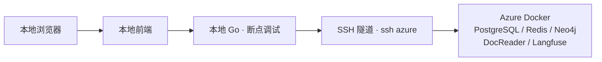

建议用 **“Azure 运行依赖服务，本地运行 Go 和前端，通过 SSH 隧道连接”**。这样既能减轻本机负担，也能继续打断点、热更新和查看 Langfuse 链路。

结合项目现有配置，这个方案改动比较小，[开发脚本](/Users/barryshen/source_code/WeKnora/scripts/dev.sh:487) 已经支持 `DEV_REMOTE_HOST`。



**服务这样分配：**

| 组件 | 运行位置 | 说明 |
|---|---|---|
| Go 后端 | 本地 | 使用 GoLand / VS Code 调试 |
| 前端 | 本地 | 保持热更新 |
| PostgreSQL / ParadeDB | Azure | 保存业务数据和向量 |
| Redis | Azure | 缓存、异步任务队列 |
| Neo4j | Azure | 图谱存储 |
| DocReader | Azure | 文档解析服务 |
| Langfuse 及其依赖 | Azure | 查看每次提问的调用链路 |
| 上传文件 | 第一阶段保留本地 | 后续需要集中存储，再迁移到服务器 MinIO |

**建议分五步落地：**

1. **检查 Azure 环境。**  
   通过 `ssh azure` 检查 Docker、内存、磁盘、现有容器及端口。你目前的 Langfuse 已配置远程地址，需要先确认是否就在这台服务器，能复用就复用。

2. **在服务器启动依赖。**  
   使用项目的 `docker-compose.dev.yml`，开启 Neo4j：

   ```bash
   make dev-start DEV_ARGS="--neo4j"
   ```

   服务器配置 `DEV_DOCREADER_MODE=docker`，并保持 `DEV_REMOTE_HOST` 为空，否则脚本会跳过启动。Neo4j 当前使用 `latest`，正式落地时建议固定兼容版本；PostgreSQL 保留项目使用的 ParadeDB 镜像。

3. **用 SSH 隧道连接服务。**  
   以下假设服务器使用默认端口，本地选择另一组端口，避免与现有 Docker 冲突：

   ```bash
   ssh -N \
     -o ExitOnForwardFailure=yes \
     -o ServerAliveInterval=30 \
     -L 127.0.0.1:15432:127.0.0.1:5432 \
     -L 127.0.0.1:16379:127.0.0.1:6379 \
     -L 127.0.0.1:15051:127.0.0.1:50051 \
     -L 127.0.0.1:17687:127.0.0.1:7687 \
     -L 127.0.0.1:17474:127.0.0.1:7474 \
     -L 127.0.0.1:13000:127.0.0.1:3000 \
     azure
   ```

   服务器上的这些端口绑定 `127.0.0.1`，通过 SSH 访问，无需逐个开放公网端口。Docker 支持这种绑定方式，详见[官方端口说明](https://docs.docker.com/engine/network/port-publishing/)。

4. **本地 `.env.local` 指向隧道。**

   ```dotenv
   DEV_REMOTE_HOST=127.0.0.1

   DB_HOST=127.0.0.1
   DB_PORT=15432
   REDIS_ADDR=127.0.0.1:16379

   DOCREADER_ADDR=127.0.0.1:15051
   DOCREADER_PORT=15051

   NEO4J_ENABLE=true
   NEO4J_URI=bolt://127.0.0.1:17687

   LANGFUSE_ENABLED=true
   LANGFUSE_HOST=http://127.0.0.1:13000
   ```

   数据库、Redis、Neo4j 和 Langfuse 的凭据同步使用服务器对应配置。Langfuse 登录回调地址也要配合本地访问地址调整。

5. **本地启动开发。**

   ```bash
   make dev-app
   make dev-frontend
   ```

   `make dev-app` 是普通运行；需要断点时，用 IDE 的 Debug 配置加载同一套环境变量启动 Go。代码修改和编译都在本地，数据库、图谱及追踪记录保存在服务器。

有三个与你这个项目直接相关的注意点：

- **迁移已有数据需要单独处理。** PostgreSQL、Neo4j、上传文件分别备份迁移；只启动容器会得到一套空环境。
- **异步任务也需要调试。** 本地后端应消费自己的任务队列；如果另一套服务器后端连接同一队列，任务可能被另一进程取走。
- **AnyDoc 仍可能在本地执行。** 当前 AnyDoc 是嵌入 Go 进程运行的，迁走 DocReader 不会自动迁走 AnyDoc。若你的目标还包括减少本地解析和编译负担，需要进一步调整解析路径。

另一种选择是 **VS Code Remote SSH，把 Go 和前端也放在 Azure 上调试**，适合进一步降低本机负担。按你“部署依赖后继续本地调试”的目标，我优先推荐上面的 SSH 隧道方案。

## app 和 frontend 容器模式

在项目根目录执行：

```bash
make dev-docker
```

该命令从当前源码分别构建两个镜像，启动开发依赖，再启动以下容器：

| 容器名称 | 镜像名称 | 默认访问地址 |
| --- | --- | --- |
| `Weknora-app-dev` | `weknora-app-dev:latest` | http://localhost:8081 |
| `Weknora-frontend-dev` | `weknora-frontend-dev:latest` | http://localhost:5175 |

前端使用 Nginx 提供构建后的页面，API 请求代理到 app 容器的 8080 端口。首次构建包含 Go、Rust 和前端依赖，耗时较长；宿主机无需安装 Go、Rust 或 Node.js。

与本地开发模式相同，先加载 `.env`，再加载 `.env.local`。复用开发环境的数据库、Redis 和文件目录（默认 `.local-data/files`），容器间连接使用内部端口，不使用宿主机的 `DB_PORT` / `REDIS_PORT`。数据库和 Redis 中的数据、队列与本地开发模式共享。

`DEV_DOCREADER_MODE=local` 时仍需在另一个终端运行 `make dev-docreader`，app 经 `host.docker.internal` 访问宿主机解析服务；否则启动并使用 DocReader 容器。可通过 `DEV_ARGS` 启用可选依赖，例如：

```bash
make dev-docker DEV_ARGS="--neo4j --no-langfuse"
```

可在 `.env.local` 中修改端口和文件目录：

```dotenv
DEV_DOCKER_APP_PORT=8081
DEV_DOCKER_FRONTEND_PORT=5175
# DEV_DOCKER_FILES_DIR=/absolute/path/to/files
```

远程依赖沿用 `DEV_REMOTE_HOST` 及连接配置；也可用 `DEV_DOCKER_DB_HOST`、`DEV_DOCKER_DB_PORT`、`DEV_DOCKER_REDIS_ADDR`、`DEV_DOCKER_DOCREADER_ADDR` 等变量单独指定容器使用的地址。自定义模型服务若运行在宿主机，应将模型地址中的 `localhost` / `127.0.0.1` 改成 `host.docker.internal`。

如果 Docker Desktop 可以拉取镜像，但构建时访问 `auth.docker.io` 失败，可在 `.env.local` 设置 `DEV_DOCKER_BUILD_PROXY=http://127.0.0.1:7897`（按实际代理端口调整）。该代理仅用于宿主机的构建命令，不会注入应用容器。

修改源码后重新执行 `make dev-docker` 构建并更新容器，此模式不提供热更新。使用 `make dev-status` 查看状态，`make dev-logs` 查看日志，`make dev-stop` 停止全部开发容器（保留数据卷）。
