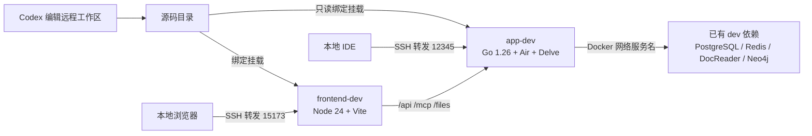

# Docker 远程开发调试手册

本手册对应仓库根目录的 [`docker-compose.remote-dev.yml`](../../docker-compose.remote-dev.yml)：在远程机器的 Docker 中运行 WeKnora 前端和 Go 后端，Codex 修改同一份远程工作区源码后自动更新服务。远程宿主机只需要 Docker、Compose、源码目录和供客户端连接的 SSH，不需要安装 Go、Node、Air 或 Delve。

这套配置只新增 `WeKnora-app-dev` 和 `WeKnora-frontend-dev`，并连接已有的 `weknora_WeKnora-network-dev`。它不会启动或重建依赖容器，也不会操作非 `dev` 容器。已有依赖至少包括 `postgres`、`redis` 和 `docreader`；Compose 也提供了 `neo4j` 地址，是否使用取决于应用配置。如需核对容器范围，只执行：

```bash
docker ps --format '{{.Names}}' | grep dev
```

## 架构与原理



### 源码如何热更新

- **前端：** `./frontend` 挂载到 Vite 容器的 `/workspace`。Vite 直接读取源码，Vue/TS/CSS 修改后通过浏览器 WebSocket 热更新。`node_modules` 和 npm 缓存分别保存在独立 Docker volume，不要求宿主机安装 npm。前端源码挂载可写，是为了允许在其下方挂载 `/workspace/node_modules`。
- **后端：** 仓库根目录只读挂载到 Go 容器的 `/workspace`。Air 监听 Go、配置和迁移文件，变动后运行 `go build`，再通过 Delve 启动新二进制。编译产物位于容器的 `/tmp/weknora-air`，Go 模块及编译缓存在专用 volume；源码改动不需要重建镜像。
- **断点：** 构建使用 `-gcflags='all=-N -l'` 保留调试信息。Delve 在容器内监听 `2345`，映射到远程宿主机回环地址的 `12345`。Air 使用 `exec dlv ...` 启动调试器，重编译时能先结束旧进程并释放端口。每次后端重启可能需要 IDE 重新连接并恢复断点。

### 请求与网络如何流转

浏览器只访问 Vite 的 `15173` 端口。前端配置中的 `VITE_DEV_PROXY_TARGET=http://app:8080` 让 Vite 将 `/api`、`/mcp/`、`/files` 转发到后端，`/api` 的 WebSocket 也会转发，因此浏览器无需直接访问数据库或后端端口。`app`、`postgres` 等名字由同一个外部 Docker 网络解析；容器中的 `localhost` 只指向容器自身，不能用来连接其他服务。

前端 `15173`、后端 `18081`、Delve `12345` 都只发布到远程主机的 `127.0.0.1`。客户端通过 SSH 端口转发访问，开发端口不直接对公网开放。Delve 所需的 `SYS_PTRACE` 和宽松 seccomp 仅作用于 `app-dev` 容器；没有挂载 Docker socket。

### 配置与数据放在哪里

| 内容 | 来源或位置 | 说明 |
| --- | --- | --- |
| 应用凭据 | 仓库根目录 `.env` | Compose 通过 `env_file` 传给 app；`.env.local` 不参与此方案 |
| 依赖地址 | Compose `environment` | 覆盖 `.env` 中可能面向宿主机的地址，例如 `DB_HOST=postgres`、`REDIS_ADDR=redis:6379` |
| 上传文件 | `weknora-remote-dev_app-files-dev` volume | 容器内路径 `/data/files`；不会自动导入宿主机旧文件 |
| Go 模块与编译缓存 | 本方案专用 Docker volume | 容器重建后保留，减少后续编译时间 |
| 前端依赖与 npm 缓存 | 本方案专用 Docker volume | 容器启动时执行 `npm ci`，热更新过程不重新安装 |

后端使用现有 PostgreSQL 数据库，默认 `AUTO_MIGRATE=true`，启动时可能修改数据库结构。本次首次部署曾将开发库从迁移版本 114 升到 115。若不希望后续自动迁移，在 `.env` 中设置 `AUTO_MIGRATE=false` 并重建 app 容器。

## 实现文件

| 文件 | 作用 |
| --- | --- |
| [`docker-compose.remote-dev.yml`](../../docker-compose.remote-dev.yml) | 只定义两个新服务、专用 volume、回环端口和已有外部开发网络 |
| [`docker/Dockerfile.app.dev`](../../docker/Dockerfile.app.dev) | 构建含 Go、编译依赖、Air、Delve 和 DuckDB 扩展的开发镜像 |
| [`docker/air.remote-dev.toml`](../../docker/air.remote-dev.toml) | 定义文件监听、Go 调试构建及 Delve 启动命令 |
| [`frontend/vite.config.ts`](../../frontend/vite.config.ts) | 提供 HMR 和 API、MCP、文件请求代理 |

## 首次部署

在**远程机器上的仓库根目录**执行。Codex 必须编辑这同一目录；如果 Codex 在另一台机器修改了另一份仓库，需要先把文件同步到这里，绑定挂载才会看到变化。

1. 确认 `.env` 已包含可用的数据库、Redis 等凭据，并用上面的筛选命令确认依赖容器已运行。配置中的 Docker 网络名固定为当前开发网络 `weknora_WeKnora-network-dev`；环境不同则先核对实际开发网络名，再调整 compose 文件。
2. 检查配置并启动两个新服务：

   ```bash
   docker compose -p weknora-remote-dev -f docker-compose.remote-dev.yml config -q
   docker compose -p weknora-remote-dev -f docker-compose.remote-dev.yml \
     up -d --build --no-deps app frontend
   docker compose -p weknora-remote-dev -f docker-compose.remote-dev.yml \
     ps app frontend
   ```

   `-p` 固定独立项目名，`-f` 限定此方案的两个服务，`--no-deps` 禁止 Compose 顺带启动依赖。首次构建会下载 Go/npm 依赖并编译含调试信息的后端，可能需要数分钟；以后源码修改直接热更新。

3. 在远程机器检查服务：

   ```bash
   curl -fsS http://127.0.0.1:18081/health
   curl -I http://127.0.0.1:15173/
   docker compose -p weknora-remote-dev -f docker-compose.remote-dev.yml \
     logs --tail=80 app frontend
   ```

   健康检查应返回 `{"status":"ok"}`，前端应返回 HTTP 200。未登录时访问 `http://127.0.0.1:15173/api/v1/system-info` 得到 401，表示请求已通过 Vite 到达后端，而不是 Vite 返回了 HTML 页面。

## 从本地访问和打断点

在**本地电脑**建立 SSH 隧道，`<remote-host>` 替换为实际 SSH 主机名或别名：

```bash
ssh -N -o ExitOnForwardFailure=yes \
  -L 15173:127.0.0.1:15173 \
  -L 12345:127.0.0.1:12345 \
  <remote-host>
```

浏览器打开 `http://127.0.0.1:15173/`。IDE 选择 **Delve remote attach**，连接 `127.0.0.1:12345`，将本地仓库根目录映射到容器内的 `/workspace`。VS Code Go 扩展可在工作区调试配置中使用以下核心字段；这里显式指定 `legacy` 适配器及 API v2，与容器内的 `dlv --headless --api-version=2` 配套。其他 IDE 配置同样的地址和源码路径映射即可。参见 [Go 扩展远程调试文档](https://github.com/golang/vscode-go/blob/master/docs/debugging.md#remote-debugging)。

```json
{
  "name": "WeKnora Docker remote",
  "type": "go",
  "debugAdapter": "legacy",
  "apiVersion": 2,
  "request": "attach",
  "mode": "remote",
  "host": "127.0.0.1",
  "port": 12345,
  "substitutePath": [
    { "from": "${workspaceFolder}", "to": "/workspace" }
  ]
}
```

如需从本地直接请求后端，可额外转发 `-L 18081:127.0.0.1:18081`；正常浏览器使用只需转发前端端口。后端代码变化会短暂中断正在进行的请求，Air 重启后可重新发起；调试连接断开时重新 attach。

## 日常操作

| 变更 | 所需操作 |
| --- | --- |
| `frontend/src` 等前端源码 | 保存文件，等待 Vite HMR；无需 Compose 命令 |
| Go 源码、Air 监听的 YAML/JSON/SQL/TOML | 保存文件，Air 自动重编译并重启 Delve |
| `.env`、Compose 环境变量 | `docker compose -p weknora-remote-dev -f docker-compose.remote-dev.yml up -d --no-deps --force-recreate app` |
| `frontend/package-lock.json` 或 `package.json` | `docker compose -p weknora-remote-dev -f docker-compose.remote-dev.yml up -d --no-deps --force-recreate frontend`，使容器再次执行 `npm ci` |
| `go.mod`、`go.sum` 或开发镜像依赖 | 重新运行首次部署命令中的 `up -d --build --no-deps app frontend` |
| Air 配置本身 | `docker compose -p weknora-remote-dev -f docker-compose.remote-dev.yml restart app`，使 Air 重新读取配置 |

日常查看状态和日志：

```bash
docker compose -p weknora-remote-dev -f docker-compose.remote-dev.yml ps app frontend
docker compose -p weknora-remote-dev -f docker-compose.remote-dev.yml logs -f app frontend
```

只停止本方案的两个容器：

```bash
docker compose -p weknora-remote-dev -f docker-compose.remote-dev.yml stop app frontend
```

`stop` 会保留数据和缓存；不要运行 `down -v` 或删除本项目的 Docker volume。也不要使用 `make dev-stop`、主 `docker-compose.yml` 或全局 Docker 清理命令来管理本方案。

## 常见问题与边界

- **后端一直处于 `health: starting`：** 首次 Go 调试构建可能耗时较长。先看 `logs app` 是否停在 `building...`；如果有编译错误，按日志修复源码后 Air 会重试。`/health` 可用前，前端 API 请求可能出现代理错误。
- **修改源码没有生效：** 确认 Codex 编辑的是远程 Docker 主机上绑定挂载的这份仓库。Go 测试文件和 Air `exclude_dir` 中的目录不会触发后端重编译；修改 `.env` 后须重新创建容器。
- **端口被占用：** 通过 `REMOTE_FRONTEND_PORT`、`REMOTE_APP_PORT`、`REMOTE_DEBUG_PORT` 调整远程宿主机端口，并同步修改 SSH `-L` 和 IDE 端口。容器内的 5173、8080、2345 不变。
- **Delve 连接中断：** 后端热更新会重启调试器。重新 attach；若端口未释放，查看 `logs app`，仅重启 `app-dev` 容器。Air 配置使用 `exec dlv` 避免旧调试器占用端口。
- **Langfuse 401：** 本方案默认 `LANGFUSE_ENABLED=false`，因为 `.env` 现有密钥可能不属于开发实例。确认密钥属于现有 `langfuse-web-dev` 项目后，再以 `REMOTE_LANGFUSE_ENABLED=true` 重新创建 app。
- **与生产镜像的差异：** 前端由 Vite 服务而非 Nginx；本开发镜像未构建 AnyDoc 静态库，且默认关闭 BrowserSkill 和需要 Docker socket 的沙箱功能。验证这些功能或 Nginx 专用路由时，应另用对应镜像和配置，不将本开发环境视为生产等价环境。
