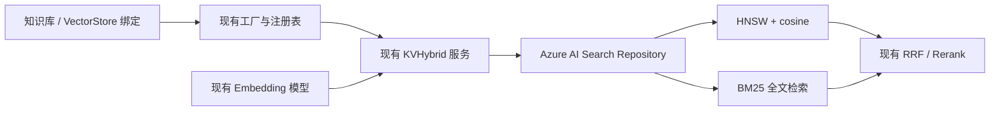

# Azure AI Search：接入设计与任务清单

> 设计与实现日期：2026-10-20。已接入后端驱动、实例管理、知识库维度约束和前端配置。真实 Azure 环境验收仍待执行；使用说明见 [检索引擎文档](../../website-docs/03-features/05-retrieval-engines.md#azure-ai-search)。

## 1. 推荐方案

新增检索引擎 `azure_ai_search`，展示名称为 **Azure AI Search**，复用现有「VectorStore 实例 → 知识库绑定 → 检索引擎工厂」机制。

- WeKnora 继续负责解析、分块、生成问题、Embedding、RRF 融合和 Rerank；Azure 负责索引、向量检索及全文检索。
- 新增 `internal/application/repository/retriever/azureaisearch/`，实现 `RetrieveEngineRepository` 和 `KnowledgeIndexMover`。
- 服务层复用 `NewKVHybridRetrieveEngine`，不新增一条独立的 RAG 流程。
- 首版采用「一个 VectorStore 对应一个固定维度的 Azure 索引」。不同维度创建不同实例，避免跨索引查询、更新路由和 BM25 分数合并问题。
- 首版支持后台创建实例、知识库绑定、多实例、API Key 与托管身份；环境变量默认引擎作为后续扩展。

Azure Search Service 由用户预先创建；应用按需创建自己管理的索引。首版不接管任意已有业务索引，不集成 Azure Indexer、Skillset、自动向量化、Semantic Ranker 或 Azure 原生 hybrid。



## 2. 当前代码中的接入位置

| 位置 | 职责与改动 |
| --- | --- |
| `internal/types/retriever.go` | 增加 `AzureAISearchRetrieverEngineType = "azure_ai_search"` |
| `internal/types/vectorstore.go` | 引擎白名单、连接配置、索引配置、默认值、表单字段元数据 |
| `internal/types/interfaces/retriever.go` | 沿用现有索引、检索、复制和更新接口；无需修改公共签名 |
| `internal/container/engine_factory.go` | 增加工厂分支及运行时地址校验，传入 store.ID / store.TenantID |
| `internal/application/service/vectorstore.go` | 认证参数、维度、名称和 SSRF 校验 |
| `internal/application/service/vectorstore_healthcheck.go` | 增加连接测试 |
| `internal/application/service/retriever/factory.go` | 沿用实例归属验证和按需加载，不绕过工厂直接查注册表 |
| `internal/application/service/knowledgebase_search_fanout.go` | 将新引擎加入已知引擎列表 |
| 知识库创建、配置变更、导入及移动校验路径 | 增加 Azure 实例维度与 Embedding 维度兼容检查 |
| `frontend/src/views/settings/VectorStoreSettings.vue` | 认证模式切换、条件必填、实例配置及测试反馈 |
| `frontend/src/api/vector-store.ts` | 复用现有 API；按需扩展表单元数据 |
| `frontend/src/views/knowledge/settings/KBVectorStoreSettings.vue` | 实例选择、维度提示与校验反馈 |

`vector_stores` 已使用字符串引擎类型与 JSON 配置，新增字段通常不需要 DDL 迁移；实现时同时检查 PostgreSQL / SQLite 的实际约束。

## 3. 实例配置

### 3.1 建议字段

| 配置位置 | 字段 | 说明 |
| --- | --- | --- |
| `connection_config` | `addr` | 复用现有字段，填写 `https://<service>.search.windows.net` |
| `connection_config` | `auth_mode` | 新增，`api_key` 或 `managed_identity` |
| `connection_config` | `api_key` | 复用现有加密、脱敏字段，仅 Key 模式必填 |
| `connection_config` | `managed_identity_client_id` | 新增，可选，指定用户分配身份；为空使用系统分配身份 |
| `index_config` | `index_name` | 复用字段，Azure 表单标为「索引名称前缀」，默认 `weknora` |
| `index_config` | `vector_dimensions` | 新增，必填正整数，必须等于知识库 Embedding 输出维度 |
| `index_config` | `text_analyzer` | 新增，默认 `standard.lucene`；中文场景可选择 `zh-Hans.microsoft` |

首版 HNSW 参数使用驱动默认值，metric 固定为 cosine；不复用 OpenSearch 的 KNNEngine 或其参数取值范围。分片和副本由 Azure 服务容量管理，表单不展示其他引擎的 shards / replicas。

REST 数据面先固定 `api-version=2025-09-01`，这是明确选定的兼容基线，不表示它是最新版本。升级应通过兼容性验证，不允许用户输入任意版本。[官方版本列表](https://learn.microsoft.com/en-us/rest/api/searchservice/search-service-api-versions)

```json
{
  "name": "Azure 生产知识库检索",
  "engine_type": "azure_ai_search",
  "connection_config": {
    "addr": "https://example-search.search.windows.net",
    "auth_mode": "managed_identity"
  },
  "index_config": {
    "index_name": "weknora",
    "vector_dimensions": 1536,
    "text_analyzer": "zh-Hans.microsoft"
  }
}
```

首版沿用实例创建后只改名称的规则，维度、分析器和物理索引位置不可在线修改。更换这些配置需要新实例并重建索引；仅维度一致并不足以保证不同 Embedding 模型的向量可以混用。

### 3.2 认证与连接测试

- Key 模式使用可管理索引并读写文档的 Admin Key；Query Key 无法完成写入与建索引。
- 托管身份使用 `azidentity.ManagedIdentityCredential`，显式选择系统或用户分配身份；不在生产环境隐式回退到开发者登录或其他身份。
- 数据请求使用 Azure AI Search 的令牌 scope；首版面向 Azure 公有云，其他云需同时设计 Endpoint 与身份 audience。
- 按需建索引需要索引管理权限，日常写入和查询需要对应数据权限。部署文档分别说明 `Search Service Contributor`、`Search Index Data Contributor` 与 `Search Index Data Reader` 的适用范围。[官方 RBAC 说明](https://learn.microsoft.com/en-us/azure/search/search-security-rbac)
- 切换认证模式时清理无关凭据；Key 不进入日志或明文返回值。沿用项目现有加密机制，并验证部署确实提供加密密钥。
- 连接测试执行只读数据面请求，不创建临时索引，也不声称只读探测已验证全部写权限。Azure 托管服务不返回可用作服务器版本的产品版本号，`TestConnection` 成功时 version 留空，API 版本独立管理。

现有 raw-test API 只接收 connection_config，因此连接测试先保持「认证与可达性」语义。索引 schema、维度及建索引权限在实例准备/首次写入时验证，并给出明确错误；若要增加完整就绪检查，另行扩展请求，不能把它悄悄塞入 version。

### 3.3 网络边界

Azure Endpoint 必须使用 HTTPS，不允许 URL 用户信息、查询串或额外路径；首版只接受合法的公有云 Search Service 主机名。Private Endpoint 仍使用服务标准域名，由私有 DNS 解析，并按项目现有 SSRF 白名单策略显式放行。

创建、测试、运行时加载以及实际 HTTP 连接均执行地址策略；禁用重定向，校验证书，避免凭据被转发。身份 SDK 访问 Azure 身份端点是独立的 SDK 流程，不接受用户配置的任意元数据 URL。

## 4. 物理索引与 Schema

### 4.1 索引命名及生命周期

物理索引名为 `<prefix>-<store_uuid去连字符>-v1`。完整 store UUID 构成命名空间；前缀最长 92 字符，为后缀预留长度。同一 Endpoint 和前缀可创建多个实例，例如分别使用 768 和 1536 维。接口和 UI 可展示实际索引名，前缀不应伪装成现有索引名。

- 一个实例一个物理索引，向量维度在创建时固定；纯关键词记录不写 embedding，仍存在同一索引。
- Repository 从工厂获得固定的 storeID / tenantID，不依赖后台任务 context 一定携带 TenantInfo。
- 首次写入按需创建。多进程通过条件创建处理竞争；冲突后读取并验证字段、维度、算法、分析器及所有权标记，不覆盖已有不兼容 schema。
- 查询路径不创建索引；尚未建立索引的新实例返回空结果，权限错误和其他 404 必须按具体错误码区分。
- 删除 VectorStore 沿用软删除和知识库绑定保护，不默认删除 Azure 物理索引。物理清理单独执行，必须核对所有权。

Azure 向量字段需要在 schema 中声明维度、算法与 profile；变更不兼容定义应重建索引。[官方向量索引说明](https://learn.microsoft.com/en-us/azure/search/vector-search-how-to-create-index)

### 4.2 字段映射

| 字段 | Azure 类型 / 属性 | 作用 |
| --- | --- | --- |
| `id` | `Edm.String`，key、filterable、sortable | 稳定物理主键与游标扫描 |
| `tenant_id` | `Edm.String`，filterable | 由 Repository 注入，防止 JSON 数字精度问题 |
| `store_id` | `Edm.String`，filterable | 实例隔离与管理校验 |
| `write_token` | `Edm.String`，filterable、retrievable | 写入版本及检索可见性确认 |
| `content` | `Edm.String`，searchable、retrievable | 分块或生成问题文本，全文检索 |
| `embedding` | `Collection(Edm.Single)`，searchable | 固定维度，HNSW / cosine profile |
| `chunk_id` / `source_id` | `Edm.String`，filterable、retrievable | 分块定位与不同索引来源 |
| `source_type` | `Edm.Int32`，filterable、retrievable | 保持现有枚举语义 |
| `knowledge_id` / `knowledge_base_id` | `Edm.String`，filterable、retrievable | 文档及知识库过滤 |
| `knowledge_type` / `tag_id` | `Edm.String`，filterable、retrievable | FAQ、普通文档及标签过滤 |
| `is_enabled` / `is_recommended` | `Edm.Boolean`，filterable、retrievable | 状态和推荐标记 |

物理 `id = hex(SHA256(规范编码的 tenantID、storeID、sourceType、sourceID))`，不能仅使用 chunkID。项目的生成问题使用独立 SourceID，同一个 ChunkID 可能对应多条索引；更新和删除分块时必须作用于全部关联记录。业务返回的 `IndexWithScore.ID` 保持现有上层依赖的业务标识，物理主键仅由驱动使用，实施时用调用方契约测试锁定。

embedding 保留 `stored=true`、`retrievable=true`，以支持复制时读取向量，以及只更新元数据时保留原向量；常规查询通过 `select` 排除 embedding。[官方向量存储选项](https://learn.microsoft.com/en-us/azure/search/vector-search-how-to-storage-options)

## 5. 检索行为

### 5.1 通用过滤

构造专用 OData filter builder，所有值转义，不接受 `AdditionalParams` 中的原始表达式。

- 强制 store / tenant 范围，正常检索强制 `is_enabled eq true`。
- 应用已授权的 KnowledgeBaseIDs，以及 KnowledgeIDs、TagIDs、ExcludeKnowledgeIDs、ExcludeChunkIDs。
- 用户检索缺少已授权知识库范围时拒绝执行，不能退化成整个索引搜索。共享知识库继续使用现有授权后解析到的所属实例，不以请求者 tenant 覆盖实例 owner。
- `KnowledgeType=faq` 精确匹配 FAQ；现有调用以空字符串表示普通文档的向量查询时，归一化为项目当前的文档类型常量。关键词调用按现有知识库范围工作，不将空值一律解释为全类型访问。
- 管理扫描不加 enabled 限制，否则禁用记录无法被复制、移动和删除；仍保持 store、tenant、KB / 文档范围。

### 5.2 向量检索

使用 Documents Search POST：`kind=vector`，`fields=embedding`，`k/top` 对应 TopK，显式设置 `vectorFilterMode=preFilter`。校验向量非空、维度一致、数值有限；TopK 超出选定 API 的支持范围时返回校验错误，不静默截断。[官方过滤模式说明](https://learn.microsoft.com/en-us/azure/search/vector-search-filters)

必须在驱动内将 Azure 原始分数转换为项目使用的 cosine：

```text
azure_score = 1 / (1 + cosine_distance) = 1 / (2 - cosine)
cosine = 2 - 1 / azure_score
```

例如 cosine 为 0.8 时 Azure 返回约 0.833333。先做转换，再按 `RetrieveParams.Threshold` 过滤，并按项目规则约束到 [0, 1]；检查原始分数为零、NaN 等异常。不能直接把 Azure score 交给只执行 clamp 的通用 normalizer。[官方分数定义](https://learn.microsoft.com/en-us/azure/search/vector-search-ranking)

### 5.3 关键词与混合检索

- 关键词查询只发送 `search`，指定 `searchFields=content`，保留 BM25 原始分数，按现有关键词阈值语义过滤。
- 首版锁定 simple query 的转义和词项组合规则，使用中文、英文及特殊符号样本验证，避免无意启用完整 Lucene 查询语法。
- 分别返回 vector / keywords 对应的 `RetrieveResult`、引擎类型与 MatchType；每次驱动调用遵守现有结果封装约定。
- 统一由现有服务层 RRF 去重融合，继续使用现有 Rerank；不对同一请求再执行 Azure 原生 hybrid，避免重复融合及混用 RRF 分数和 cosine 阈值。
- 跨实例向量检索继续遵守「同一 Embedding 模型语义」校验，不因维度相同就放行。

## 6. 写入、更新、复制、移动及删除

### 6.1 写入与错误处理

`Save/BatchSave` 读取现有 `params["embedding"]`，按 SourceID 匹配向量，并保持 chunk_enabled 等已有参数语义。使用稳定主键和完整 `upload` 执行幂等替换；元数据更新使用 `merge`，禁止用 `mergeOrUpload` 意外制造没有正文的记录。

批请求按文档数和实际序列化字节数双重分包：最多 1,000 条、整个请求小于 16 MB，驱动取保守上限预留空间。服务层当前常用小批量不能替代驱动限制。每条响应均检查成功状态，部分失败仅重试可重试条目，永久错误返回失败条目摘要；413 重新拆包，单条过大直接报错。429、503 和短暂网络故障按 Retry-After / 指数退避与抖动重试，遵守 context 与总重试预算。[官方批量写入与部分失败说明](https://learn.microsoft.com/en-us/azure/search/search-how-to-large-index)

`EstimateStorageSize` 继续返回明确标注的逻辑估算；Azure 实际容量含向量索引和副本等开销，不把估算当作云账单或服务统计值。

### 6.2 接口映射

| 现有接口 | Azure 实现 |
| --- | --- |
| `DeleteByChunkIDList` | 按 chunk_id 扫描所有 SourceID 对应主键，再批量 delete |
| `DeleteBySourceIDList` | 根据 source_id 查询或推导完整主键，批量 delete |
| `DeleteByKnowledgeIDList` | 按 knowledge_id 扫描主键，再批量 delete |
| `BatchUpdateChunkEnabledStatus` | 扫描该 chunk 的所有记录，再按主键 merge is_enabled |
| `BatchUpdateChunkTagID` | 扫描后 merge tag_id；空字符串明确表示清空 |
| `CopyIndices` | 分页读出正文、元数据和向量，映射 KB / 文档 / chunk / source，重算目标主键后 upload |
| `MoveKnowledgeIndices` | 校验源 KB + 文档 + chunk 范围，merge 目标 KB 并清空 KB 范围内 tag，保留 ID 与向量 |

Azure 文档删除按 key 执行，方案不能照搬其他引擎的 delete-by-query 或 update-by-query。[Documents Index API](https://learn.microsoft.com/en-us/rest/api/searchservice/documents/?view=rest-searchservice-2025-09-01)

扫描采用 `search="*"`、`orderby=id asc`、`filter=id gt lastID` 的游标分页，字段显式 filterable/sortable，不使用持续增大的 skip。响应中的 continuation 按所选 API 的实际协议处理，不能遇到第一页未满就无条件结束。[官方分页说明](https://learn.microsoft.com/en-us/azure/search/search-pagination-page-layout)

复制必须覆盖关键词记录、禁用记录和生成问题。生成问题 SourceID 通过现有规则映射；没有直接规则的来源使用基于源记录及目标映射的确定性 ID，重试不能随机生成新副本。目标 tag 按现有复制业务约定映射或清空，不能带入不属于目标 KB 的标签。移动仅支持现有业务允许且维度/模型兼容的范围，不能用「复制后按 knowledgeID 删除」模拟。

Azure 写入并非事务，也不保证确认后立刻可检索。驱动为每批 upload/merge 写入版本 token，在返回成功前有界轮询该版本的检索可见性（最多 45 秒，服从调用方 context）；超时返回可重试错误。删除和复制沿用后台任务、稳定映射及幂等重试；不在扫描过程中允许源数据持续改变。任务层需要冻结相应文档的写入或基于权威数据库的稳定源记录集合执行；分页游标本身不提供快照。删除后有界等待检索可见性并再次核对，不能以第一次查到零条就证明刚提交的并发数据已删除。

## 7. 维度与迁移约束

- 绑定知识库及选择模型时检查实例 vector_dimensions 和 Embedding 模型输出维度。初始化向导允许暂未选择模型；选定模型后必须具有明确且相同的维度。
- 写入和查询必须再次检查实际向量长度，避免模型配置漂移。
- 纯关键词知识库允许不提供向量；其记录仍使用同一固定 schema。
- 文档移动、知识库复制若目标不兼容，在任何索引写入前失败。
- 已有知识库切换到 Azure 必须使用项目支持的重建/迁移流程；仅改 vector_store_id 不会迁移已有索引。若当前绑定接口没有迁移保障，首版只允许新库或空库选择 Azure，已有库需另行重建。
- 非空 Azure 知识库更换 Embedding 模型会被拒绝，即使维度相同也需在新知识库重建。纯关键词记录的复制、移动和删除使用实例固定维度，不依赖模型存在。

## 8. 实施顺序与验收

### P1：配置与驱动

- [x] 增加引擎类型、字段元数据、后端校验、加密脱敏与 Azure 专属表单。
- [x] 增加固定 API 版本的窄 REST Client；认证使用 api-key 或 azidentity。错误类型区分认证、权限、本地维度、schema、限流、临时网络故障及逐条写入失败，保留 HTTP 状态用于定位容量等服务错误。
- [x] 实现索引 schema、条件创建、所有权验证和只读连接测试。
- [x] 实现单条/批量写入、向量检索、全文检索、过滤与分数转换。

### P2：应用集成及完整生命周期

- [x] 接入 EngineFactory、按需加载与已知引擎列表；复用现有授权及跨实例融合。
- [x] 知识库新建、导入、配置变更与移动加入维度/模型兼容校验。
- [x] 实现状态/标签更新、三种删除、CopyIndices、MoveKnowledgeIndices 及一致性重试。
- [x] UI 显示认证模式、维度、中文分析器、物理索引名和错误反馈；补图标与多语言文案。

### P3：验证与发布文档

- [x] 使用 `httptest` 验证请求/响应契约、OData 转义、分数和阈值边界、分页、批量部分失败、重试及取消。
- [x] 验证一个 chunk 的正文与多个生成问题不互相覆盖，禁用/改标签/删除会命中全部记录。
- [x] 验证跨租户、跨 store、共享 KB、异步任务缺少 TenantInfo 的场景，以及无权限时不发出查询。
- [x] 验证同名索引创建竞争、schema 漂移、多进程懒加载恢复及不兼容移动提前失败。
- [ ] 真实 Azure 测试验证 Key / 托管身份、中文检索、复制不重复计算 Embedding、复制重试不重复、更新后向量保留、删除最终不可检索。
- [x] 用超过扫描单页上限的数据和服务端不足一页的响应验证扫描及删除；验证稳定映射、部分失败与幂等重试。真实多进程并发写入故障验收留在 Azure 环境进行。
- [x] 做现有引擎、跨实例 RRF 和知识库 CRUD 回归；补充服务配置、权限、私网、容量与迁移说明。

发布门槛是「实例配置 → 建库 → 导入 → 向量/关键词/混合检索 → 禁用/改标签 → 复制/移动 → 删除 → 重启恢复」完整闭环，不能只完成检索 API 就开放生产使用。

## 9. 后续扩展

- `RETRIEVE_DRIVER=azure_ai_search` 与环境变量实例：需要先解决共享 env 实例在同步与异步路径中的 tenant 作用域传递，不能直接复用 DB 实例固定 owner 的假设。
- 预创建索引模式与细化 RBAC、凭据轮换机制；现有 VectorStore 更新接口当前仅支持名称，这些均需单独设计。
- 自动按维度拆索引、Azure 原生 hybrid / Semantic Ranker、向量压缩和更大规模迁移，按实际需求另行引入。
- Azure 中国区及其他云：验证服务能力、API 版本、域名和身份 audience 后提供独立配置。

## 10. 本地验证命令

```bash
# 配置、驱动、生命周期及跨实例检索回归
GOMAXPROCS=4 go test -p 1 ./internal/types ./internal/application/service/retriever ./internal/application/service ./internal/container
# REST 契约与竞态检测，无需 Azure 凭据
go test -race ./internal/application/repository/retriever/azureaisearch
# 在 frontend 目录执行
npm test -- src/views/settings/azureAISearchForm.test.ts src/i18n/localeKeyAudit.test.ts
npm run type-check
npm run build
```

这些测试使用模拟 Azure 数据面响应；不会创建或修改真实 Azure 资源。前端标准构建在本机并发任务较多时出现 Less worker 超时；使用相同 Vite 配置并覆盖 `css.preprocessorMaxWorkers: 0` 后构建通过，类型检查及 16 个表单/多语言测试通过。Azure 驱动的 `-race` 测试通过。

最终本地验证：`internal/application/service`、`internal/container`、`internal/types`、`internal/application/service/retriever` 全包回归通过；Azure Repository 竞态测试通过。回归时修正了 SSRF 测试白名单的隔离/恢复，未修改生产 SSRF 策略。真实 Azure 环境验收仍未执行。

## 11. 2026-10-21 首次建索引的 404 兼容修复

真实服务只读排查发现，索引不存在时 Azure 可能返回空 `error.code`，消息为 `No index with the name '<index>' was found in the service '<service>'.`。原驱动仅识别另一种 `The index ... was not found` 文案，导致首次导入直接失败而未执行条件建索引。

现在同时识别两种明确指向当前索引的响应，其他索引或未知路由的 404 仍返回错误。回归覆盖首次写入自动建索引、首次查询不建索引、旧文案兼容及无关 404 拒绝；先复现原失败，再修复，Repository 全包 `-race` 通过。本次真实服务检查只读取索引定义/列表，写入闭环仍需运行修复版本后重新解析文档验证。

## 12. 2026-10-21 Azure Schema 默认值兼容修复

加载 404 修复后，真实服务已自动创建应用专属索引，但字段校验报 `field id`。只读获取索引定义确认：Azure 在普通字段和向量字段上均返回 `stored: true`，而驱动创建普通字段时省略此属性。结构体直接比较将 nil 与 true 错判为 Schema 漂移。

校验现将两侧省略的 `stored` 归一化为默认值 true，显式 false 仍拒绝；所有权、字段类型、维度、分析器和向量配置的校验保持严格。测试先复现真实响应导致的失败，新增普通字段/向量字段的省略、显式 true、显式 false 回归；模拟服务的建索引及读取响应也统一返回 Azure 的 `stored: true` 默认值。
